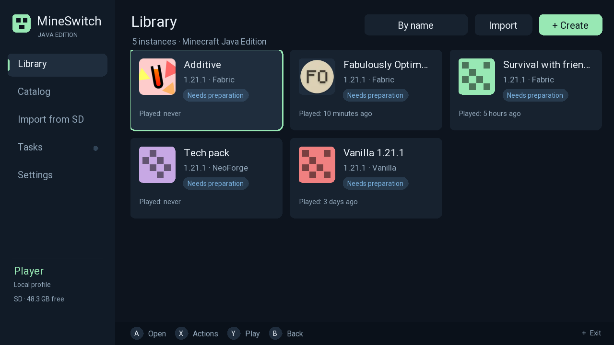
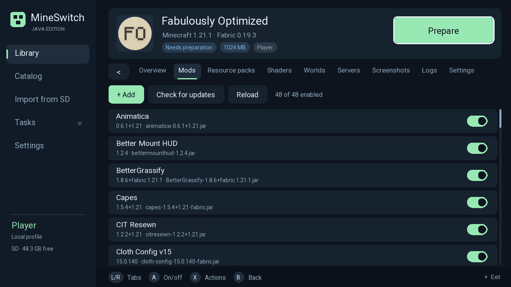
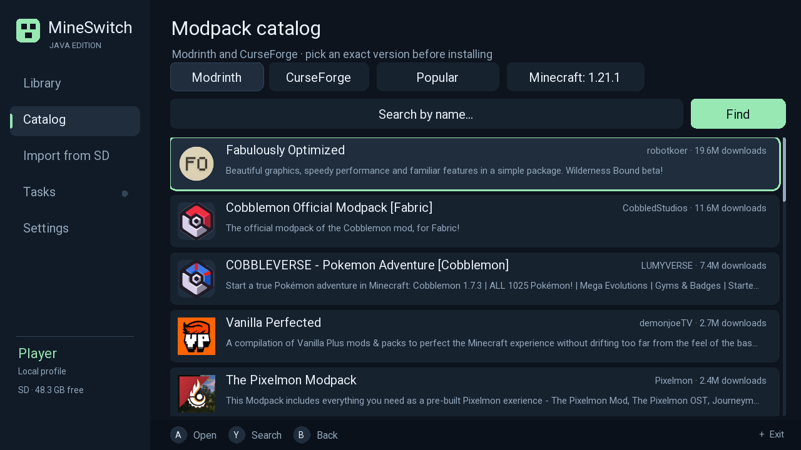
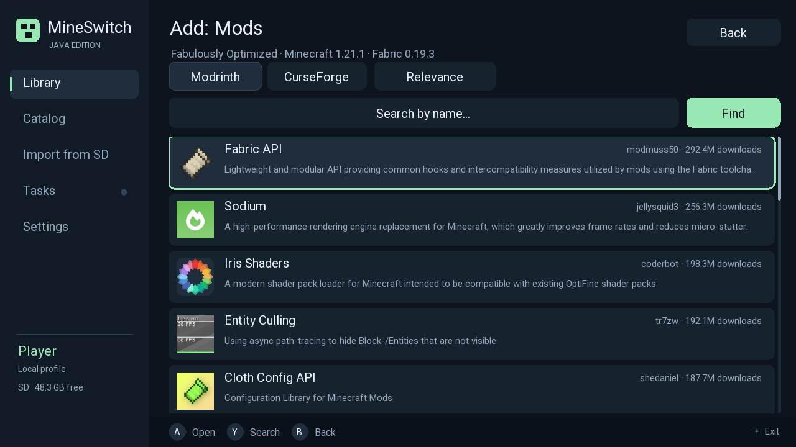

# MineSwitch

**Minecraft: Java Edition 1.21.1 running natively on the Nintendo Switch** (Horizon OS, Atmosphère).
No Linux, no emulation, no streaming: a real OpenJDK 21 HotSpot with the C1/C2 JIT
ported to Horizon, Vulkan through a Mesa NVK fork (NXVK) with Zink providing OpenGL,
and a PolyMC-style launcher that runs on the console.

<p align="center">
  
  
</p>
<p align="center">
  
  
</p>

## Status

Tested on a Switch OLED (Atmosphère, application mode):

| Area | Result |
| --- | --- |
| JVM | OpenJDK 21 HotSpot for `aarch64-unknown-horizon`: template interpreter, C1 and C2, SerialGC, `-XX:+UseCompressedOops` |
| Graphics | NXVK (Vulkan, Mesa NVK fork) + Zink → OpenGL for LWJGL 3.3.3 |
| Game | Minecraft 1.21.1 with **Fabric** — verified with the Fabulously Optimized modpack and with Fabric + Sodium: world generation, play, saving; ~87 FPS flying over a world |
| Memory | Java heap up to **1900 MiB** (standard process budget); mimalloc 2.2.4 with a shared page pool and GPU buffer aliasing |
| CPU | 4 cores via the NSP forwarder (core 3 unlocked in the NPDM) |
| Startup | ~55 s to the title screen, ~63 s into a world |
| Launcher | Instances, version/loader wizard, mods / resource packs / shaders from Modrinth and CurseForge with dependencies and updates, worlds, servers, screenshots, logs, import of `.mrpack` / CurseForge ZIP / MultiMC-PolyMC-Prism exports, packwiz packs |

Not verified yet or not done:

- **NeoForge / Forge**: supported by the launcher, not yet run on the console.
- **Java 17 and Java 8** are built and linked ([JAVA17_PORT](docs/JAVA17_PORT.md),
  [JAVA8_PORT](docs/JAVA8_PORT.md)), but not tested on the device or wired into the launcher.
- No Microsoft account sign-in: offline profiles only.
- Mods that ship native desktop libraries (voice chat, video players, etc.) will not work.

## Requirements

- A Nintendo Switch running Atmosphère (tested on OLED). **Application mode** is required
  for the full memory budget: launch through the NSP forwarder, or from hbmenu while
  holding **R** over a game. Applet mode (Album) does not have enough memory.
- **Overclocking.** The game runs at stock clocks, but not comfortably. For comfortable play,
  overclock the **CPU and RAM** significantly (e.g. sys-clk with an OC module for Atmosphère);
  overclock the **GPU** too if you want more FPS. MineSwitch never changes clocks itself.
- **Controller support** inside the game needs a mod such as
  [Controlify](https://modrinth.com/mod/controlify) — install it from the launcher
  (instance → Mods → Add). The launcher itself is fully controller- and touch-driven.
- About 3 GB of free SD card space, plus room for instances.
- Your own copy of Minecraft: Java Edition. This project **does not distribute** any Mojang
  code or assets; the launcher downloads them from Mojang's servers on the console.

## Installation

1. Download `MineSwitch.nro` from [Releases](../../releases) and copy it to
   `sdmc:/switch/mineswitch/MineSwitch.nro`.
2. Start it from hbmenu while holding **R** over any game (full memory), or build and
   install the NSP forwarder (see below) — MineSwitch then appears on the HOME menu and
   gets 4 CPU cores and +96 MiB of memory.
3. In the launcher: Library → create an instance (version + loader) → Play.
   Ready-made modpacks: Catalog (Modrinth / CurseForge) or Import from SD
   (put archives into `sdmc:/switch/mineswitch/imports/`).
4. The launcher is in English by default; Russian can be selected in Settings.

Launcher controls: [launcher/README.md](launcher/README.md).

## How it fits together

```
MineSwitch.nro
├── launcher (SDL2 + FreeType, C++17)        launcher/
│   catalogs, imports, instance preparation, packwiz
└── runtime                                   runtime/launcher/
    ├── OpenJDK 21 HotSpot, statically linked runtime/patches/openjdk21-horizon.patch
    ├── JDK and LWJGL native libraries        runtime/lwjgl/, runtime/glfw/
    ├── NXVK / Zink                           runtime/graphics/nxvk/
    ├── mimalloc for Horizon                  runtime/memory/mimalloc/
    ├── file I/O, JAR cache                   runtime/io/
    └── JDK image in RomFS                    runtime/build-image.sh
```

| Directory | Contents |
| --- | --- |
| `launcher/` | The launcher: UI, storage, catalogs, imports, mods, packwiz, host tests |
| `runtime/` | OpenJDK port (patches, build scripts), JVM host, graphics, memory, I/O |
| `runtime/patches/` | OpenJDK 21/17/8 Horizon patches, applied to pinned upstream commits |
| `runtime/forwarder/` | NSP forwarder build (needs your own console keys) |
| `runtime/maintenance/` | Development helper NRO for deploying builds over the network |
| `minecraft/` | Minecraft launch preparation and JDK module policy |
| `diagnostic/`, `graphics/`, `vm-probe/` | Small diagnostic NROs from the early bring-up |
| `docs/` | Porting notes and on-device results (mostly in Russian) |
| `scripts/` | Toolchain bootstrap, running NROs over NXLink, log analysis |

## Building

Requires Linux x86_64, Python 3.12+, GNU Make, a host JDK 21 (boot JDK) and ~15 GB of
disk. All builds go through `runtime/limit-build.py` (6 jobs, nice 15 by default).

1. **Toolchain** — devkitA64/libnx from a pinned devkitPro image layer (SHA-256 checked):
   ```sh
   python3 scripts/bootstrap-toolchain.py
   ```
2. **OpenJDK 21** — pinned sources + the Horizon patch, then HotSpot server and native
   libraries ([runtime/README.md](runtime/README.md), [runtime/JIT_BUILD.md](runtime/JIT_BUILD.md)):
   ```sh
   python3 runtime/bootstrap-openjdk.py
   export MINESWITCH_JVM_VARIANT=server MINESWITCH_JDK_CONF=horizon-aarch64-server-release
   bash runtime/configure-horizon.sh
   bash runtime/build-horizon.sh hotspot
   bash runtime/build-horizon.sh java.base-libs
   ```
3. **Runtime dependencies**: mimalloc (`runtime/memory/mimalloc/build.py`),
   NXVK (`runtime/graphics/nxvk/configure-local.py`), LWJGL
   (`runtime/lwjgl/build_native.py`, `build_java.py`), GLFW (`runtime/glfw/`).
4. **JDK image and native symbol registry**:
   `runtime/build-jit-image.sh` → `runtime/generated-native-minecraft/`.
5. **Final NRO** (launcher + runtime):
   ```sh
   python3 runtime/limit-build.py -- make -C runtime/launcher -j6 \
     DEVKITPRO=$PWD/.toolchain/opt/devkitpro DEVKITA64=$PWD/.toolchain/opt/devkitpro/devkitA64 \
     REGISTRY=$PWD/runtime/generated-native-minecraft/native_registry.c \
     ROMFS=$PWD/runtime/generated-native-minecraft/romfs \
     APP_MODE=launcher GRAPHICS_BACKEND=nxvk ALLOCATOR_BACKEND=mimalloc \
     ALLOCATOR=$PWD/runtime/memory/mimalloc/build-s18/libmineswitch_mimalloc.a \
     PROFILE_ALLOC=1 GPU_ALIAS=1 RECLAIM_NXVK=1 COMPACT_VM=1 \
     BUILD=$PWD/runtime/launcher/build OUTPUT=$PWD/dist/MineSwitch
   ```
6. **NSP forwarder** (optional; keys are never stored in the repository or the output):
   ```sh
   python3 runtime/forwarder/build.py --keys /path/to/prod.keys
   ```

A from-scratch build is not yet a single script; steps 3–4 are described in more detail
in [docs/PORT_PROGRESS.md](docs/PORT_PROGRESS.md) and the per-component documents.

The launcher also builds and runs on a Linux desktop for development and tests
(SDL2, FreeType, Jansson, libcurl, minizip, libwebp, mbedTLS):

```sh
python3 runtime/limit-build.py -- make -C launcher -j6 check ui-check
```

## Documents

Most porting notes are in Russian.

- [Java 21 on Horizon](docs/JAVA21_PORT.md), [JIT bring-up](docs/JIT_BRINGUP.md)
- [Porting progress](docs/PORT_PROGRESS.md), [on-device baseline](docs/DEVICE_BASELINE.md)
- Memory: [mimalloc on Horizon](docs/MIMALLOC_HORIZON.md), [NXVK memory](docs/NXVK_MEMORY.md),
  [JIT memory on Horizon](docs/HORIZON_JIT_MEMORY.md)
- Horizon specifics: [stack guards](docs/HORIZON_STACK_GUARDS.md),
  [thread scheduling](docs/HORIZON_THREAD_SCHEDULING.md), [process exit](docs/HORIZON_PROCESS_EXIT.md)
- Launcher: [mod management](docs/MOD_MANAGEMENT.md), [controllers](docs/LAUNCHER_CONTROLLERS.md),
  [validation](docs/LAUNCHER_VALIDATION.md), [game startup analysis](docs/MINECRAFT_STARTUP_ANALYSIS.md)

## License and legal

The project's code is licensed under [GPL-2.0](LICENSE).

MineSwitch is an unofficial project, not affiliated with Mojang, Microsoft or Nintendo.
Minecraft is a trademark of Mojang Synergies AB. This repository contains no code, assets
or keys from Mojang or Nintendo.

Third-party code: OpenJDK (GPLv2 + Classpath Exception; patches only here),
Mesa (MIT), mimalloc (MIT), LWJGL (BSD-3), GLFW (zlib), newlib, stb_image (public domain),
nx-hbloader / NTON (ISC). Upstream sources are fetched by the build scripts at pinned versions.
